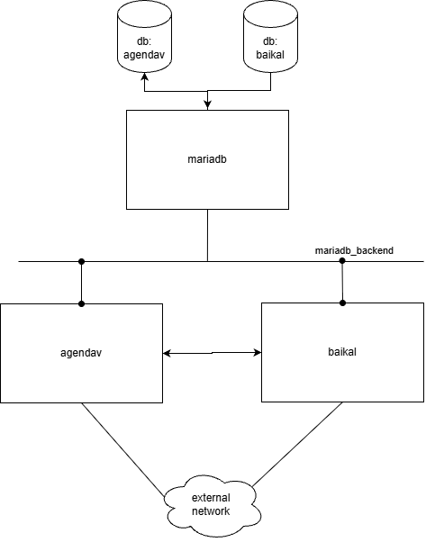
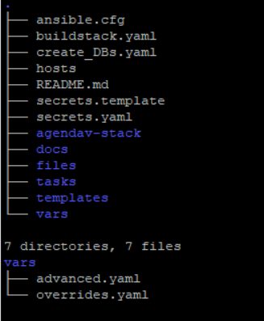
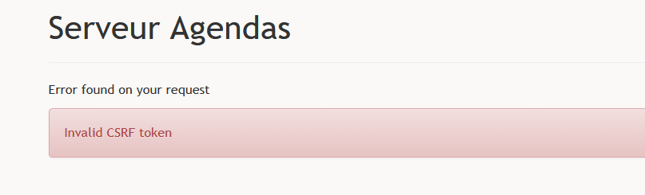

# Agendav playbooks

## Introduction

The purpose of these ansible playbooks is to generate a docker compose file which will be used to deploy a complete [agendav ](https://github.com/agendav/agendav))stack.

The diagram below represents the stack configured by the playbooks. 



By default , the playbooks will deploy agendav in `dev`mode and the components can be accessed using plain http. The dev mode is not recommended by the agendav development team (for security reasons among other reasons)

It is possible to deploy agendav in `prod`mode but this requires to access agendav and baikal using https. (typically via a reverse proxy). This is the kind of setup I use in my homelab. For now this documentation will focus on `dev` mode where baikal and agenda can be accessed using plain (unencrypted) http.

In the appendix, I explain how I deploy agendav in prod mode in my environment

## Prerequisites

I deploy on Ubuntu server 26.04 with 

- docker 29.8.2 (Community)

- ansible 2.20

- git (I have 2.53.0)

You will also need a network access to pull the docker images

The agendav image being used can be found [here](https://github.com/chris4474/agendav-docker). This is a fork of [nagimov/agendav-docker](https://github.com/nagimov/agendav-docker). 

## Preparations

```bash
git clone https://github.com/chris4474/agendav-playbooks.git
cd agendav-playbooks
git checkout 
```

The diagram below shows the directory structure of the playbooks. The actual structure may differ slightly but the main files are shown below:



`ansible.cfg`: By default this file specifies the name of a file which contains your password if you decide to encrypt `secrets.yaml` with ansible-vault. . You will have to create this file and put your vault password there.   `ansible.cfg` also specifies a default ansible inventory which happens to be the `hosts` file in the same directory. I recommend you open it to see exactly what it does,

`secrets.yaml`, This file  contains all the secrets that you need to configure before deploying the stack. This is where you store credentials (root password of the mariadb engine, database users, baikal admin password etc). The file secrets.template can be used as a template. 

 `vars/overrides.yaml`. This is where you can change the easy stuff such as timezones, start of week (1 for monday, 0 for sunday)  and language.

`vars/advanced.yaml` You are not supposed to make changes here unless you know exactly what you are doing and have a good understanding of how ansible playbooks work.

By default, if you make no change to the files in the `vars/`  directory the playbook will configure agendav in `dev` mode (with debug options enabled in the code) and you will be able to access baikal and agendav from the outside (inside=being the docker host where you deploy the stack)

## Generating the Docker compose files (and more)

The playbook `buildstack.yaml` is used to generate the docker compose file that will deploy the architecture described above. To generate the full stack run the following command: (in the same directory as `buildstack.yaml`)

`$ ansible-playbook buildstack.yaml`

If not present the directory `agendav-stack`is created  which will contain everything required by the main docker compose file : `./agendav-stack/compose.yaml`

In the `agendav-stack` directory you will also find sub-directory, one for each component , `mariadb`, `baikal` `agendav` and`db-init container`. 

**note**: the db-init component is the component which creates the two databases and loads the DB schema required by  `baikal`.

## Deploy the whole stack in one shot

Before you can deploy the stack you need to create the network named `mariadb_network`.

`$ docker network create mariadb_network`

You are now ready to deploy the stack:

```
cd agendav-stack
docker compose up -d
```

## Using agendav

Before you can login in `agendav` you need to create a user (and a calendar) in `baikal`

If you chose the `dev` environment, the baikal UI can be opened at `http://<ip address_of_your_docker host>:8081`

**note** If you chose the `prod` environment, you will have to access baikal and agendav over https. A reverse proxy  is your best frined in this case.

## Appendix: prod mode deployment

When deployed in prod mode agendav needs to be accessed using https and needs to communicate with baikal using https as well. 

### Case 1: Reverse Proxy and Agendav stack on different machines.

This is how I do it in my test environment where the server hosting the stack and the server hosting the reverse proxy are two separate servers.

I apply the following changes to `vars/overrides.yaml`

```
agendav_environment: prod
agendav_server_name: agendav.test.mydomain.fr
agendav_caldav_public_url: baikal.test.mydomain.fr
agendav_published_port: 0.0.0.0:8080
baikal_published_port: 0.0.0.0:8081
```

Where agendav.test.mydomain.fr and baikal.test.mydomain.resolve to the IP adress of my reverse proxy. I also have valid certificates for both names.

I run the build_stack.yaml playbook then i run the deploy.sh script

I can then create users in baikal by opening https://baikal.test.mydomain.fr

agendav is at https://agendav.test.mydomain.fr

**note**: if you try to reach agendav directly on the host where the stack is deployed using http://<ip_address_of_host>:8080/ you will see the login screen but will not bale able to login (invalid CSRF token)



### Case 2: Reverse Proxy and Agendav Stack on same host

Documentation work in progress

(Typical setup with a Synology NAS)

```bash
../vars/overrides.yaml:agendav_published_port: 127.0.0.1:8080
../vars/overrides.yaml:baikal_published_port: 127.0.0.1:8081
```

tip: If you don't have the certificates you can access baikal using http using socat

Because my docker host is a server (no graphical interface) I use `socat` to mirror the baikal port 127.0.01: 8081 with the IP address of the host

```bash
 sudo socat TCP-LISTEN:8081,fork,bind=<ip_addr> TCP:127.0.0.1:8081 &
```

When done I can reach the Baikal UI form outside and add users and calendars

## Deployment on Synology DSM 7.2

**Step1**: The playbook generates a file named `stack.tar` in the `agendav-stack` directory. Copy this file to the Docker shared folder of you Synology and ssh to the synology.

```bash
$ cd <Docker Directory>
$ tar -xvf agendav-stack.tar
$ cd agendav-stack
$ mv dsm-compose.yaml compose.yaml # effectively delete the old version of compose.com
```


****Step2**: Start the stack

You can do it from the shell if you are still connected to the Synology server with:

```
 $ cd <directory containing the compose.yaml file>
 $ docker compose up -d
```

Alternatively use the DSM Container Manager:  create a project, select the folder your created durind step1 and chose to use the existing compose file.


**note** On my NAS mariadb took too much time to start the first time and the stack failed.  If this happens start the stack a second time.

**note**: Because I use the login portal/reverse proxy I configure the following ports as shown below (vars/overrides.yaml) before running the playbook `buildstack.yaml`. Which means you dont have to open the ports 8080 and 8081 in the firewall.

```
baikal_published_port: 127.0.0.1:8081
agendav_published_port: 127.0.0.1:8080
```
